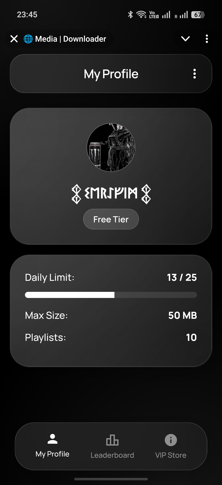
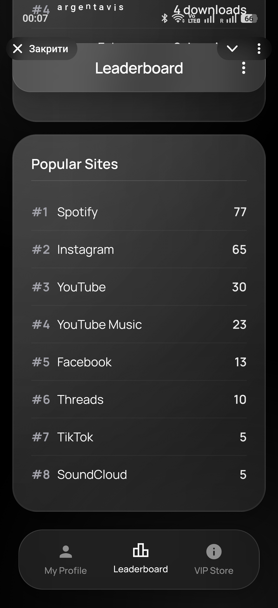
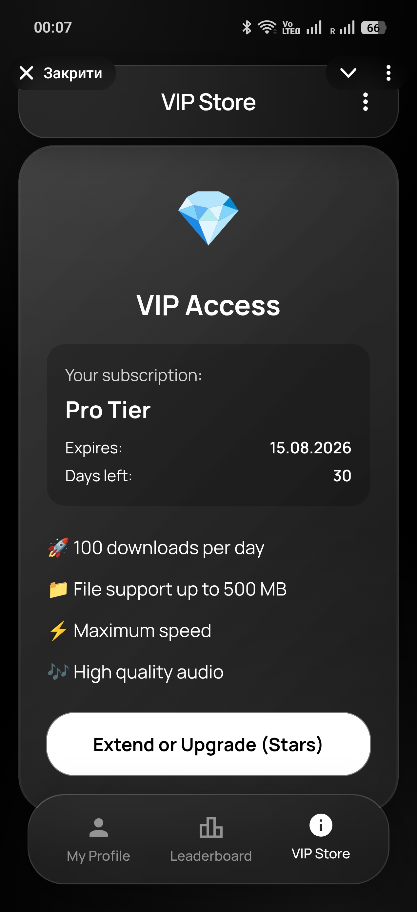
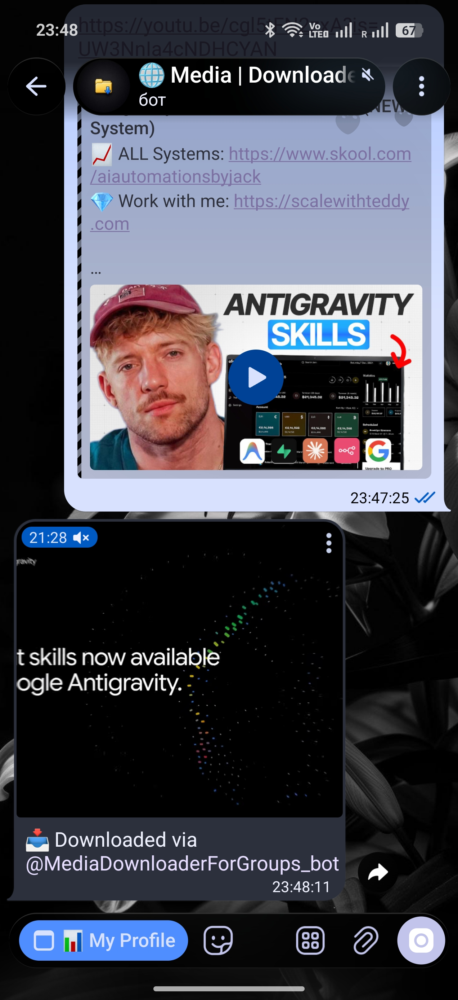
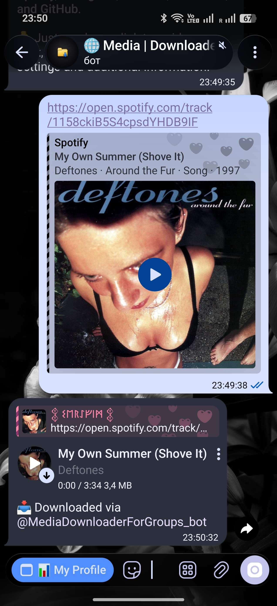
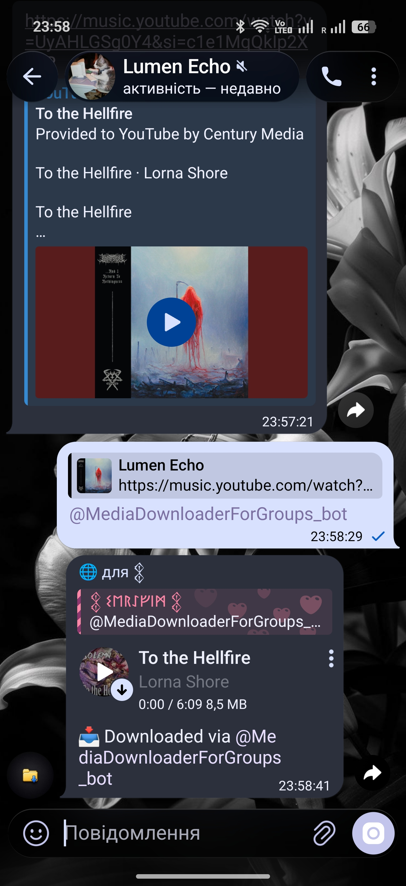

<p align="center">
  <a href="README.md">🇬🇧 English</a> | <a href="README.uk.md">🇺🇦 Українська</a> | <b>🇵🇱 Polski</b>
</p>

<div align="center">
  <h1>🚀 Media Downloader Bot</h1>
  <p>Funkcjonalny bot Telegram do pobierania treści multimedialnych z popularnych platform i serwisów społecznościowych.</p>
</div>

<p align="center">
  <a href="https://github.com/dmytrokurochkin/Media-Downloader-Bot/actions/workflows/tests.yml">
    
  </a>
</p>

<p align="center">
  <a href="https://t.me/SaveMDLBot">
    
  </a>
</p>

## 📖 O projekcie

**Media Downloader Bot** to nowoczesny bot Telegram zbudowany w oparciu o Python (Aiogram 3), który umożliwia użytkownikom wygodne pobieranie wideo, audio i zdjęć z platform takich jak YouTube, YouTube Music, SoundCloud, Spotify, TikTok, Instagram, Threads, Facebook oraz GitHub.

Projekt zawiera zintegrowaną **Telegram Mini App** (Web App) z nowoczesnym interfejsem, w której użytkownicy mogą przeglądać własne statystyki, limity, rankingi oraz wykupić dostęp VIP za pomocą wewnętrznej waluty **Telegram Stars**. Do niezawodnej obsługi dużych plików (do 2 GB) wykorzystywany jest lokalny serwer Telegram Bot API.

---

## ✨ Główne funkcje

- 🎬 **YouTube i YouTube Music**: Pobieranie filmów i plików audio w najwyższej dostępnej jakości (przy użyciu `yt-dlp`).
- 📸 **Instagram, Facebook i TikTok**: Zapisywanie filmów (Reels, TikTok), postów i karuzeli (przy użyciu `gallery-dl` oraz `yt-dlp`).
- 🧵 **Threads**: Natywne wsparcie pobierania treści multimedialnych.
- 🎵 **Spotify**: Pobieranie pojedynczych utworów i playlist z zachowaniem metadanych i okładek (przy użyciu `spotdl`).
- 🎧 **SoundCloud**: Szybkie pobieranie utworów audio i setów muzycznych w wysokiej jakości.
- 💻 **GitHub**: Szybkie pobieranie kodu źródłowego repozytorium w formacie `.zip`.
- 📱 **Nowoczesna Web App**: Zintegrowana mini-aplikacja z profilem użytkownika, rankingiem oraz sekcją subskrypcji.
- 💎 **Monetyzacja**: Wbudowany system poziomów dostępu (Free, Pro, Max, VIP) z obsługą płatności przez Telegram Stars.
- 🚀 **Obsługa dużych plików**: Pobieranie i wysyłanie plików o rozmiarze do 2 GB dzięki lokalnemu serwerowi Telegram Bot API.

---

## 🖼️ Demonstracja

| Menu główne i Mini App | Ranking (Leaderboard) | Sklep VIP (Store) |
| :---: | :---: | :---: |
|  |  |  |
| **Pobieranie z YouTube** | **Muzyka ze Spotify** | **Tryb gościa** |
|  |  |  |

---

## 🛠 Stos technologiczny

- **Backend**: Python 3.11+, [Aiogram 3](https://docs.aiogram.dev/en/latest/)
- **Baza danych**: SQLite (przy użyciu `aiosqlite`)
- **Komponenty pobierania**: `yt-dlp`, `gallery-dl`, `spotdl`
- **Przetwarzanie mediów**: `FFmpeg`, `mutagen`, `Pillow`
- **Frontend (Web App)**: HTML5, CSS3, Vanilla JS
- **Infrastruktura**: Lokalny [Telegram Bot API Server](https://github.com/tdlib/telegram-bot-api)

---

## ⚙️ Wdrożenie lokalne

### 1. Klonowanie repozytorium
```bash
git clone https://github.com/dmytrokurochkin/Media-Downloader-Bot.git
cd Media-Downloader-Bot
```

### 2. Konfiguracja środowiska
Skopiuj `.env.example` do `.env` i uzupełnij — każda zmienna jest tam opisana. Minimalnie potrzebne są:
```env
BOT_TOKEN=twój_token_bota
LOCAL_API_SERVER_URL=http://127.0.0.1:8081
API_ID=twój_api_id
API_HASH=twój_api_hash
```

### 3. Instalacja zależności
Upewnij się, że w systemie zainstalowane są `ffmpeg` i [Deno](https://deno.com) 2.3+: `yt-dlp` potrzebuje środowiska JavaScript do wyzwań YouTube, bez niego YouTube zwraca tylko część formatów albo nic.
```bash
python -m venv venv
source venv/bin/activate  # Dla Windows: venv\Scripts\activate
pip install -r requirements.txt
```

### 4. Uruchomienie bota
```bash
python main.py
```

---

## 🚀 Wdrożenie na serwerze (Ubuntu/Debian)

Repozytorium zawiera skrypt do automatycznego wdrożenia bota razem z lokalnym serwerem Telegram API. Skrypt samodzielnie zainstaluje wymagane zależności, skompiluje serwer, utworzy wirtualne środowisko Python i skonfiguruje odpowiednie usługi `systemd`.

```bash
git clone https://github.com/dmytrokurochkin/Media-Downloader-Bot.git
cd Media-Downloader-Bot
chmod +x auto_deploy.sh
./auto_deploy.sh
```

Po pomyślnym wykonaniu skryptu bot będzie działał nieprzerwanie w tle.
Aby sprawdzić logi systemowe, użyj polecenia:
```bash
sudo journalctl -u tg-media-bot -f
```

Aby zastosować aktualizacje, uruchom `./auto_deploy.sh` ponownie (zrestartuje usługi). `UPDATE_BOT_API=1 ./auto_deploy.sh` dodatkowo przebuduje Telegram Bot API Server z najnowszych źródeł. Baza jest codziennie kopiowana do `backups/` (zostaje 14 najnowszych kopii) — kopiuj je także poza serwer.

## 🍪 Ciasteczka (18+ i treści tylko po zalogowaniu)

YouTube 18+, Instagram, Facebook i TikTok często wymagają zalogowania. Bot używa ciasteczek **osobnego konta** dla każdego serwisu:

1. Załóż dla bota osobne konto (nie prywatne): serwisy mogą je ograniczyć za automatyczne pobieranie. Dla treści 18+ konto musi być pełnoletnie i z potwierdzonym wiekiem.
2. Otwórz prywatne okno przeglądarki i zaloguj się. Dla YouTube w tej samej karcie otwórz `youtube.com/robots.txt`.
3. Wyeksportuj ciasteczka rozszerzeniem «Get cookies.txt LOCALLY» (format Netscape), zamknij prywatne okno i nie otwieraj więcej tej sesji — inaczej serwis odświeży ciasteczka, a wyeksportowane przestaną działać.
4. Wyślij plik botowi na prywatnym czacie z podpisem `/cookies` (tylko administratorzy). Bot zachowa tylko ciasteczka obsługiwanych serwisów, usunie wiadomość z plikiem i pokaże, co zapisał. `/cookies` bez pliku pokazuje stan i tę samą instrukcję.

Programy pobierające dostają osobną kopię ciasteczek przy każdym pobieraniu, więc równoległe pobierania nie psują już `cookies.txt`. Gdy serwis przestaje akceptować ciasteczka, administratorzy dostają wiadomość z poradą. Jeśli serwisy blokują IP serwera («potwierdź, że nie jesteś botem»), ustaw `DOWNLOAD_PROXY` w `.env`.

## 🔒 Bezpieczeństwo

- Lokalny Bot API Server działa jako osobny użytkownik `tgbotapi` i nasłuchuje tylko na `127.0.0.1`. W trybie `--local` może odczytać dowolny lokalny plik dla dowolnego tokena, więc nigdy nie wystawiaj portu `8081` na zewnątrz.
- Wewnętrzne API bota też nasłuchuje tylko na localhost; wystawiaj je wyłącznie przez HTTPS (ngrok lub reverse proxy).
- Linki od użytkowników są sprawdzane pod kątem adresów prywatnych i wewnętrznych (łącznie z każdym przekierowaniem) przed pobraniem.
- Trzymaj `.env`, `cookies.txt`, `database.db` i `backups/` w tajemnicy: skrypt wdrożenia ustawia im uprawnienia `600`.

## ⚠️ Informacje prawne (Disclaimer)

Ten projekt został stworzony **wyłącznie w celach edukacyjnych i badawczych**, jako demonstracja możliwości tworzenia botów, integracji z API oraz przetwarzania plików multimedialnych.
Autorzy i współtwórcy nie ponoszą żadnej odpowiedzialności za wykorzystanie tego oprogramowania przez użytkowników końcowych w sposób, który może naruszać prawa autorskie, przepisy jakiegokolwiek kraju lub Regulamin (Terms of Service) platform zewnętrznych. Pobierając treści, użytkownik jest zobowiązany przestrzegać obowiązującego prawa i szanować prawa twórców.

---

## 🤝 Współtworzenie
Zapraszamy do wszelkiego wkładu w rozwój projektu. W przypadku istotnych zmian prosimy najpierw utworzyć issue, aby omówić proponowane zmiany. Zobacz [CONTRIBUTING.md](CONTRIBUTING.md) (po angielsku), aby dowiedzieć się, jak skonfigurować środowisko deweloperskie, uruchomić testy i zgłosić pull request. Prosimy również przestrzegać naszego [Kodeksu postępowania](CODE_OF_CONDUCT.md). Znalazłeś lukę bezpieczeństwa? Zobacz [SECURITY.md](SECURITY.md).
